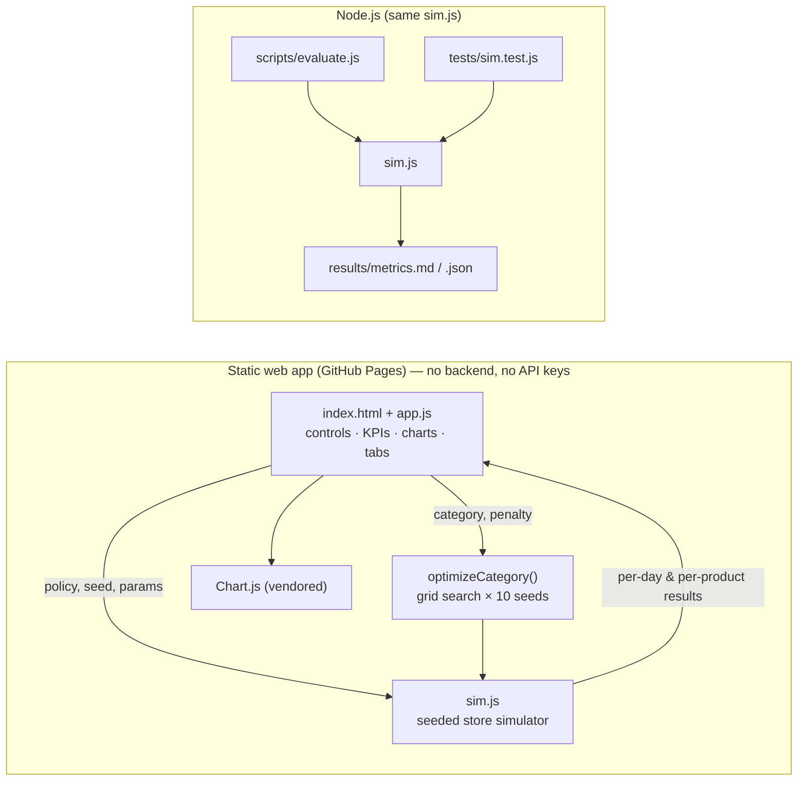

# Markdown Before Waste: near-expiry pricing simulator

**NexAI Hack 2026 · Track 4 (AI for Supply Chain & Logistics) · PS 4.1**

🔗 **Live app:** https://Yasash77.github.io/markdown-before-waste/ &nbsp;·&nbsp; 📽️ **Demo video:** _add YouTube link_ &nbsp;·&nbsp; 📓 [DEV_LOG.md](DEV_LOG.md) &nbsp;·&nbsp; 📊 [results/metrics.md](results/metrics.md)

> All data is **synthetic**, generated by my simulator. There is no real store data. Every number below can be reproduced with `node scripts/evaluate.js`.

---

## 1. Problem

Grocery stores throw away perishables (bread, milk, produce, meat, ready meals) that reach their expiry date unsold. Discounting earlier sells more of them, but discounting too much or too soon eats the margin. Shoppers who would have paid full price take the cheaper unit instead.

There is no ready dataset for this. I built a store simulator, wrote down and justified every assumption, and used it to test markdown rules against fixed pricing. I report **waste and margin side by side**, so a rule that discounts everything cannot look like a win.

## 2. What I found (30-day simulation, mean of 10 seeds)

| Policy | Waste reduction vs fixed price | Margin change vs fixed price | Lost sales (empty shelf) |
|---|---|---|---|
| Aggressive discounts 20 / 40 / 50 % (2 days / 1 day / last day) | **−99.3 %** | **−20.0 %** ❌ | 111 → 530 |
| Gentle 0 / 20 / 40 % | −98.8 % | +4.9 % | 111 → 255 |
| **★ Recommended category rules** (my optimiser) | **−79.5 %** | **+15.9 %** ✅ | 111 → 139 |

**Out-of-sample check.** The optimiser only ever saw seeds 1–10. On 30 seeds it never saw (101–130), the optimised rules still cut waste by **81.3 %** and raised margin by **15.8 %**.

**Robustness.** The optimised rule cuts waste and keeps or grows margin in **8 of 9** assumption scenarios (shopper response 0.5×/1×/1.5× × overstock 1.1×/1.2×/1.3×). The one exception: shoppers respond only half as strongly *and* the store barely overstocks, where margin moves −1.6 %. See [results/metrics.md](results/metrics.md).

**Takeaways**
1. Discounting hard on the last 2–3 days removes nearly all waste, but it gives away margin to shoppers who would have paid full price anyway (cannibalisation). It also empties shelves faster, so lost sales rise about 5×.
2. Small, **late**, category-specific markdowns (10–20 %, mostly on the last day) recover most of the waste value without training shoppers to wait for deals.
3. Short-shelf-life, high-cost items (chicken, fish, sandwiches, salads, strawberries) gain the most. Bakery with daily delivery barely needs markdowns.
4. Low-margin staples (milk, ₹52 cost vs ₹60 price) lose money at fixed price because of waste. A small markdown turns them profitable.

## 3. What I built

| Requirement | Where |
|---|---|
| **MVP 1:** simulator for one store, 20 perishables, 30 days, batches with expiry dates, demand depends on price and days to expiry, every assumption documented | `js/sim.js`, the [Assumptions](#5-assumptions) section and the in-app *To-do list* tab → "How the numbers are worked out" |
| **MVP 2:** two policies, fixed price vs a markdown rule with adjustable thresholds | Sliders for the 2-day / 1-day / last-day discount, plus presets |
| **MVP 3:** deployed dashboard; both policies on the same seed; units wasted, revenue, margin; per-product view of what was marked down and when | *Dashboard* and *Per-product* tabs (day × product heatmap, daily chart, comparison table) |
| ⭐ Stretch: search for the best discount steps per category | *Optimiser* tab: grid search over 120 monotone rules × 10 seeds per category, optional waste penalty, out-of-sample check |
| ⭐ Stretch: sensitivity panel ("what if shoppers respond half as strongly?") | *Robustness* tab: 3 × 3 grid of shopper response × overstock, plus a seed-by-seed chart |
| ⭐ Stretch: shopper-facing "today's deals" page | *Today's deals* tab: generated from the simulation for any day |
| Extra: waste-vs-margin frontier of every store-wide rule | Scatter chart on the Dashboard |
| Extra: cost-floor guardrail ("never price below cost") | Scenario controls |
| Extra: plain-English verdict ("win–win" / "trade-off: ₹X of margin per unit of waste avoided") | Top of the Dashboard |
| Extra: "₹ thrown away" KPI (value of binned stock at cost) | Dashboard KPIs |
| Extra: shareable scenario links (rule, seed and settings stored in the URL) | "Copy link to this exact scenario" button |
| Extra: CSV export of per-product results for both policies | *Per-product* tab |
| Extra: printable shelf-edge labels from the deals page | *Today's deals* → "Print shelf labels" |
| Extra: **"Fresh Finds" shopper storefront**: a separate consumer UI with hero banner, search, category chips, 4 sort orders, photo/emoji product cards with real savings and best-before dates, a quick-view pop-up, a demo basket ("you save ₹X") and an honest "good food rescued" panel. No fake urgency: stock counts and dates come from the simulation | Sign in as 🛒 Shopper |
| Extra: **light / dark mode toggle** (🌙 / ☀️), saved per browser and following the device setting by default; real product photos (Wikimedia Commons, credited in §11) with hover zoom | Header of every view |
| Extra: console polish: gradient header, animated KPI count-up, confetti when the verdict turns win-win, hover lifts. All motion is switched off for users who prefer reduced motion | Manager / analyst views |
| Extra: **Staff to-do list**: a daily checklist in plain words (receive deliveries, price stickers, shelves to watch, items to remove at closing, tomorrow's delivery), with tick-off, WhatsApp copy and print | *To-do list* tab (assumptions folded underneath) |
| Extra: **Recommended next steps** action planner. Every suggestion (switch pricing rule, soften markdowns on a category, order more or less of a product, pilot first, today's markdowns) is re-simulated on 10 seeds before it is shown and ranked by ₹ impact, with one-click Apply and a "Copy action plan" button | Dashboard, below the KPIs |

### Roles (demo sign-in)

The app opens on a role picker, and each role sees only its own screens and actions:

| Role | Sees | Can do |
|---|---|---|
| 🧑‍💼 Store manager | Every tab | Change the rule, apply recommendations, **save the rule as the store rule (demo, this browser only)**, print labels |
| 📊 Analyst | Dashboard, Per-product, Optimiser, Robustness, To-do list (incl. assumptions) | Explore scenarios, run the optimiser, export CSV. Can't apply or save the store rule |
| 🏷️ Shelf staff | To-do list and Today's deals, for the **saved store rule** | Tick off daily tasks, print shelf labels |
| 🛒 Shopper | Today's deals only | Browse reduced items. No stock counts, costs or internal data |

"Switch role" in the header changes role. A link can open straight into a role (e.g. `#role=staff`). The saved store rule is kept in the browser's `localStorage`. **There are no passwords:** this is a static prototype with no backend, so role views separate what each person sees but are not a security boundary. Real accounts would need a server-side auth provider.

## 4. Architecture



**Simulation loop (per product, per day):**
1. **Morning delivery:** order-up-to 1.2× expected demand until the next delivery. Units that expire before then do not count as stock. Bakery and ready meals arrive daily; dairy, produce and meat every 2 days. The ordering rule is identical for every pricing policy.
2. **Price:** each batch is priced by its days left (2 days left / 1 day left / last day). A batch is never discounted on its arrival day.
3. **Shoppers:** regular shoppers ~ Poisson(avg demand × weekday factor). A discount *x* adds bargain shoppers ~ Poisson(avg demand × weekday × sensitivity × *x* × response).
4. **Choice:** if marked-down units are on the shelf, 50 % of regular shoppers take one (cannibalisation). Otherwise a regular shopper takes the oldest unit 60 % of the time and the freshest 40 % of the time. Bargain shoppers only buy marked-down units.
5. **Close:** units on their last day are thrown away, and their cost is lost.

**Fair comparison:** common random numbers. Each (seed, product, day) has its own random streams, so both policies see the same regular shoppers.

**Tech stack:** vanilla JavaScript (ES2017), HTML, CSS, [Chart.js 4.4.1](https://www.chartjs.org/) (MIT, vendored in `vendor/`), Node.js 18+ for the tests and evaluation script. No build step, no backend, no API keys.

## 5. Assumptions

| Assumption | Value | Why |
|---|---|---|
| Horizon | 30 days, day 0 = Monday, 1 store, 20 products, 5 categories | As required by the problem statement |
| Weekday demand shape | Mon 0.90 · Tue 0.85 · Wed 0.90 · Thu 0.95 · Fri 1.10 · Sat 1.25 · Sun 1.05 (mean 1.0) | Grocery traffic peaks at the weekend |
| Daily demand | Poisson(avg demand × weekday factor) | Standard model for independent customer arrivals |
| Replenishment | Order-up-to 1.2× expected demand until next delivery; expiring units don't count as stock | Stores keep shelves full ("empty shelves don't sell"), which creates the overstock that becomes waste |
| Delivery cadence | Bakery and ready meals daily; dairy, produce, meat & fish every 2 days | Typical for fresh categories |
| Shelf life | 2 days (fish, sandwich, salad) to 10 days (flavoured yogurt) | Typical retail sell-by windows |
| No day-one markdown | A fresh batch is never discounted on arrival | Stores don't mark down a fresh delivery |
| Shelf picking | 60 % of full-price shoppers take the front (oldest) unit, 40 % dig for the freshest | Partial stock rotation: why old units get left behind |
| Cannibalisation | 50 % of regular shoppers take a marked-down unit if one is on the shelf | The margin cost of discounting; tested in the sensitivity panel |
| Discount lift | Extra bargain shoppers ∝ sensitivity × discount; sensitivity 1.2 (milk, staple) to 3.5 (croissant, salad, strawberries, impulse items) | Staples are bought regardless of price; impulse items react strongly to deals |
| Prices and costs | ₹, approximate Indian urban retail; gross margins 13 % (milk) to 43 % (salad) | Plausible relative margins; absolute ₹ values matter less than ratios |
| Margin | Revenue − purchase cost of all units received + ending stock at cost | Ending stock is neither waste nor profit |

All parameters live in `js/sim.js` (`PRODUCTS`, `CATEGORIES`, `WEEKDAY`, `DEFAULT_PARAMS`). The product master is also shown in the app.

## 6. Run it

```bash
git clone https://github.com/Yasash77/markdown-before-waste.git
cd markdown-before-waste
npm test               # 8 simulator tests (no dependencies)
npm run evaluate       # regenerates results/metrics.md (10 + 30 seeds)
npm start              # serves the app at http://localhost:8080 (or: python3 -m http.server 8080)
```

### Deploy (GitHub Pages, about 1 minute)
Repo → **Settings → Pages → Build and deployment → Source: Deploy from a branch → Branch: `main` / `(root)` → Save**. The app is live at https://Yasash77.github.io/markdown-before-waste/. It also deploys as-is to Vercel, Netlify or Cloudflare Pages, since it's a static site with no build command.

### Environment variables
None needed. The app has no backend and calls no external API. `.env.example` is included only to satisfy the hackathon template.

## 7. Evaluation and limitations

- **Metric (per PS):** waste reduction (%) and margin change vs fixed price, averaged over ≥ 10 seeds. Paired by seed, with the standard deviation reported. See [results/metrics.md](results/metrics.md).
- **Held-out check:** the rules were optimised on seeds 1–10 and evaluated on seeds 101–130.
- **Limitations:**
  - All data is synthetic, so the results show how the model behaves, not field evidence.
  - Shopper behaviour parameters (cannibalisation, lift) are assumptions. The sensitivity panel shows the conclusions weaken when shoppers respond less to discounts.
  - I model no cross-product substitution, no supplier lead-time uncertainty, and no long-term "shoppers learn to wait for deals" effect.
  - Markdowns increase stock-outs (lost sales) because bargain shoppers clear shelves faster. I report this rather than hide it.
  - Replenishment is a fixed rule. A real store would also adapt its ordering, which could cut waste further.

## 8. Dataset attribution and licence

- **Data:** synthetic, generated by `js/sim.js` (this repo). No personal or company data is used.
- **Chart.js 4.4.1:** MIT licence, © Chart.js contributors (vendored in `vendor/`).
- **Code:** MIT licence (see `LICENSE`).

## 9. Tools and AI assistance

- Editor/runtime: VS Code, Node.js 22, Chromium (Playwright) for screenshot checks.
- **AI coding assistant:** Claude (Anthropic) helped write the simulator, dashboard, tests and docs. All design decisions and assumptions are documented in [DEV_LOG.md](DEV_LOG.md), and I can explain every part of the code.

## 10. Team

| Name | Role | Contact |
|---|---|---|
| Yasash | Solo developer | [GitHub](https://github.com/Yasash77) |

#NEXAI2026

## 11. Photo credits

Product photos in the shopper storefront load from Wikimedia Commons under the licences below (CC BY / CC BY-SA require attribution; CC0 does not). If a photo cannot load, the card falls back to an emoji tile.

| Product | Author | Licence | Source |
|---|---|---|---|
| White bread loaf | Mike Finn | CC BY 2.0 | [Commons](https://commons.wikimedia.org/wiki/File:Tin_Loaf_-_one_slash_in_the_crust.jpg) |
| Brown bread loaf | Veganbaking.net | CC BY-SA 2.0 | [Commons](https://commons.wikimedia.org/wiki/File:Vegan_no-knead_whole_wheat_bread_loaf,_sliced,_September_2010.jpg) |
| Pav buns (6) | Mokshjuneja | CC BY-SA 4.0 | [Commons](https://commons.wikimedia.org/wiki/File:Pav_-_Bun_Maska.jpg) |
| Butter croissant | Herry Wibisono (herryway) | CC0 | [Commons](https://commons.wikimedia.org/wiki/File:Croissants_au_beurre_(18953292873).jpg) |
| Toned milk 1 L | FreeFOODPhotos | CC BY-SA 3.0 | [Commons](https://commons.wikimedia.org/wiki/File:Milk_and_straw.jpg) |
| Curd 400 g | Susan Slater | CC BY-SA 4.0 | [Commons](https://commons.wikimedia.org/wiki/File:Yoghurt_in_bowl_011715.jpg) |
| Paneer 200 g | Sonja Pauen - Stanhopea | CC BY 2.0 de | [Commons](https://commons.wikimedia.org/wiki/File:Panir_Paneer_Indian_cheese_fresh.jpg) |
| Flavoured yogurt | Famartin | CC BY-SA 4.0 | [Commons](https://commons.wikimedia.org/wiki/File:2020-02-19_16_25_58_A_cup_of_Chobani_Greek_Yogurt_with_Strawberry_on_the_Bottom_before_being_mixed_in_the_Franklin_Farm_section_of_Oak_Hill,_Fairfax_County,_Virginia.jpg) |
| Fresh cream 200 ml | Rhett Sutphin | CC BY 2.0 | [Commons](https://commons.wikimedia.org/wiki/File:Whipped_Cream.jpg) |
| Idli/dosa batter 1 kg | SijiR | CC BY-SA 3.0 | [Commons](https://commons.wikimedia.org/wiki/File:Idli_Batter.JPG) |
| Bananas (dozen) | Wilfredor | CC0 | [Commons](https://commons.wikimedia.org/wiki/File:Bunch_of_bananas_on_sale.jpg) |
| Tomatoes 1 kg | Dmitry Makeev | CC BY-SA 4.0 | [Commons](https://commons.wikimedia.org/wiki/File:Red_tomatoes._img_05.jpg) |
| Spinach bunch | Charipearl | CC BY-SA 4.0 | [Commons](https://commons.wikimedia.org/wiki/File:Fresh_Spinach_leaves.jpg) |
| Strawberries 200 g | W.carter | CC BY-SA 4.0 | [Commons](https://commons.wikimedia.org/wiki/File:Still_life_with_strawberries_in_a_crystal_bowl.jpg) |
| Iceberg lettuce | Rasbak | CC BY-SA 3.0 | [Commons](https://commons.wikimedia.org/wiki/File:Iceberg_lettuce_(IJssla_krop).jpg) |
| Coriander bunch | Kpsudeep | CC BY-SA 4.0 | [Commons](https://commons.wikimedia.org/wiki/File:Bunches_of_coriander_leaves.jpg) |
| Chicken curry cut 500 g | gran | CC BY 3.0 | [Commons](https://commons.wikimedia.org/wiki/File:Raw_chicken_thighs.jpg) |
| Fish fillet 250 g | FULVIO_TOGNON | CC0 | [Commons](https://commons.wikimedia.org/wiki/File:Raw_salmon_fillets.jpg) |
| Veg sandwich | Nags Viswanathan | CC BY-SA 4.0 | [Commons](https://commons.wikimedia.org/wiki/File:Vegetable_Sandwich_Mumbai-Style.jpg) |
| Salad bowl | Vinayakpatil1981 | CC BY-SA 4.0 | [Commons](https://commons.wikimedia.org/wiki/File:Vegitarian_green_salad_from_india.jpg) |
